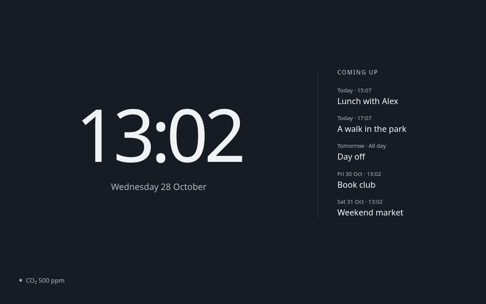
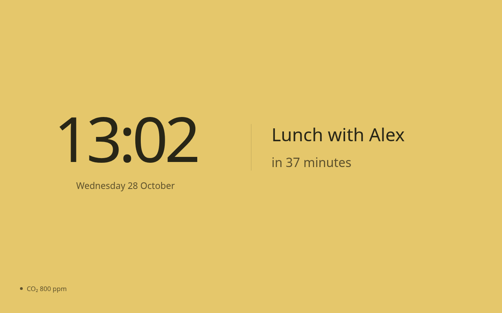
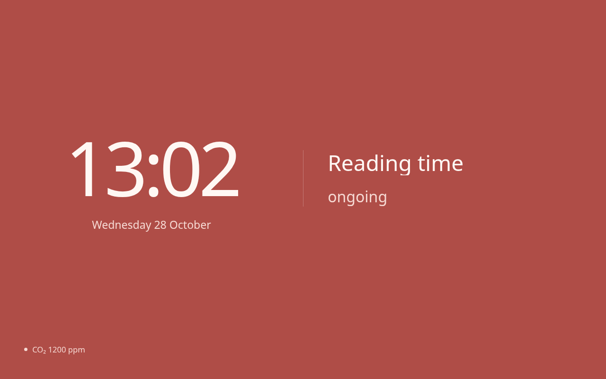

# Echo Show clock and agenda

A Home Assistant card for a quiet kiosk display: a large clock, an upcoming calendar agenda,
and an event countdown that becomes an ongoing-event display. The background reflects a CO2
sensor reading. Originally designed for an Echo Show 8 running an Android kiosk browser;
it can be used in other Home Assistant browsers too.





## Installation

Requires Home Assistant **2026.10.4 or newer**, a calendar integration exposing a `calendar.*`
entity, and a browser with modern JavaScript support. For the background indicator, select a
CO2 sensor reporting in **ppm**. There are no runtime dependencies or separate credentials.
The card uses the existing Home Assistant user's read access to the selected entities.

### HACS

1. Open **HACS → ⋮ → Custom repositories**.
2. Add `https://github.com/makkus/echo-show-card` with type **Dashboard**.
3. Find **Echo Show clock and agenda**, download it, then reload the browser.
4. Check **Settings → Dashboards → ⋮ → Resources**. If HACS has not registered the card,
   add `/hacsfiles/echo-show-card/echo-show-card.js` as a **JavaScript module**. Advanced
   mode in your user profile may be needed to see Resources. Avoid duplicate resource entries.
5. Create the dashboard below and select your entities in the card's visual editor.

The repository must contain the published files on GitHub before installation works. The
default branch can be installed before the first release; later, use versioned releases.
Adding a custom repository does not require inclusion in HACS's default catalog.
See [HACS custom repositories](https://www.hacs.xyz/docs/faq/custom_repositories/).

### Manual installation

1. Download `echo-show-card.js` from this repository or a release and copy it to
   `/config/www/echo-show-card/echo-show-card.js`.
2. Add `/local/echo-show-card/echo-show-card.js?v=0.1.0` under dashboard Resources with type
   **JavaScript module**, then reload the browser.
3. Create the dashboard below. When updating manually, replace the file, change the version
   query in the resource URL, and reload the kiosk browser.

If `www` was first created after Home Assistant started, a Core restart may be needed for
the `/local/` route. Check that the JavaScript URL loads before scheduling that interruption.
When switching from a manual install to HACS, retain only the resource for the chosen
installation so the browser loads one copy of the card.

## Create the dashboard

1. Open **Settings → Dashboards → Add dashboard → New dashboard from scratch**. Use a
   title such as **Echo Show** and URL path **echo-show**. Allow the kiosk user to access it.
2. Open the new dashboard, edit it, and apply [examples/dashboard.yaml](examples/dashboard.yaml)
   through the **Raw configuration editor**. This sets a panel view containing exactly one card.
3. Open the card's visual editor. Choose your main calendar and enter or select the CO2 sensor.
   Save, then check the live event list and numerical reading against Home Assistant.
4. Open `/echo-show/clock` on your kiosk. Record its current start URL before changing it.
   Assign this dashboard as the new kiosk start URL once it renders correctly.

The card fills the viewport below its own top edge. Home Assistant header/sidebar visibility
is controlled by your kiosk configuration. Brightness, screen sleep, voice and audio settings
remain under your existing kiosk controls.

To add it to an existing view, select **Echo Show clock and agenda** in the card picker. For
the intended full-screen layout, use a panel view with one card. The minimal card configuration is:

```yaml
type: custom:echo-show-card
calendar: ""
co2_entity: ""
```

Select the actual entities in the visual editor after adding the card. With an empty calendar,
it displays “Choose a calendar”; with an empty CO2 sensor, it displays “CO₂ unavailable”.

| Option | Purpose | Default |
| --- | --- | --- |
| `type` | `custom:echo-show-card` | Required |
| `calendar` | One calendar entity to display | Unset |
| `co2_entity` | Sensor with a numerical ppm reading | Unset |

## Display behavior

- The default view centers the clock in the left two thirds and shows up to five events over
  the next seven days on the right. Current all-day entries are included and labeled “All day”.
- A timed event starting strictly less than one hour away uses equal halves: clock left,
  title and countdown right. Remaining minutes round up; the final minute reads “in less
  than a minute”. At exactly one hour, the agenda remains visible.
- An ongoing event takes priority until its end. The earliest ongoing event wins; events
  with the same start share the title area. Each disappears at its own end. All-day events
  never take focus. Titles wrap to at most three lines, with an ellipsis for overflow.
- The clock is 24-hour `HH:MM`, with weekday and date underneath. Labels are English and
  times use Home Assistant's timezone, including all-day event dates and DST transitions.
- The background is dark neutral below 600 ppm, muted yellow from **600 through 1000**,
  and muted red **above 1000**. The numerical reading remains visible.
- An empty calendar says “No upcoming events”; a failed read says “Calendar unavailable”.
  Event details are removed after a failed read. Missing, unknown, non-numeric, negative or
  incompatible-unit CO2 readings say “CO₂ unavailable” and use the neutral background.
- On a Home Assistant disconnection, event details are removed and CO2 becomes unavailable.
  The clock continues. A calendar failure alone does not invalidate a working CO2 sensor.

Calendar range reads run every minute with a 15-second timeout. The clock and focus transitions
update locally every second. Calendar data older than 90 seconds is discarded, including on
wake after suspension. The external calendar provider's own synchronization interval also
applies. Event descriptions and locations are not displayed or logged; the card persists no
event data or credentials. No touch controls or audio are added to the kiosk display.

## Preview and development

Use **Node.js 22 or newer**. The preview and logic tests need no npm installation:

```sh
npm run preview
npm test
```

Open <http://127.0.0.1:8765/> for the interactive preview. It uses synthetic events and CO2
values, with scenario and time controls. It never connects to Home Assistant. The server binds
only to loopback and serves the two preview files and card module. Stop with Ctrl-C.
To choose another port: `npm run preview -- 8766`.

For the complete local checks:

```sh
npm ci
npm run check
npm test
npx playwright install chromium
npm run test:browser
```

Browser checks cover refresh/timeout/reconnect behavior, offline/empty states, safe title
rendering, the visual editor and layout at 1280×800, 960×600 and 800×480. Screenshots are saved
under `/tmp/echo-show-dashboard`. Set `ECHO_SCREENSHOT_DIR` to change that directory, or
`ECHO_CHROMIUM_PATH` to use an existing Chromium executable. An external Playwright module
can be supplied with `ECHO_PLAYWRIGHT_MODULE`.

The `echo-show-card.js` file in the repository root is both source and installable artifact.
There is no build step. Playwright is a development dependency and is not installed into HA.
See [release instructions](docs/releasing.md) for packaging and GitHub metadata.

The APIs were checked against Home Assistant Core 2026.10.4, and the card was tested in local
Chromium with synthetic data. Real calendar permissions and on-device WebView rendering must
still be checked during installation.

## Troubleshooting and removal

- **Custom element does not exist:** check the resource URL returns JavaScript, its type is
  module, and reload the browser. Check that it is registered only once.
- **Calendar unavailable:** confirm the calendar exists, its integration is available, and
  the kiosk's logged-in user has read access. Provider synchronization can delay edits.
- **CO₂ unavailable:** select the actual sensor and verify a numerical value in ppm in HA.
- **Navigation still visible:** configure your existing kiosk's fullscreen/navigation controls.
  Panel view controls card layout; it does not hide Home Assistant chrome.
- **Updates look unchanged:** reload the kiosk after HACS updates. For manual installation,
  change the resource version query as well.

To revert the kiosk, restore its recorded previous start URL. Remove references to this card
from dashboards before uninstalling it or removing its resource. Keep your calendars, sensors
and integrations intact. A full Home Assistant restore is not needed to undo card installation.

## License

[MIT](LICENSE).
